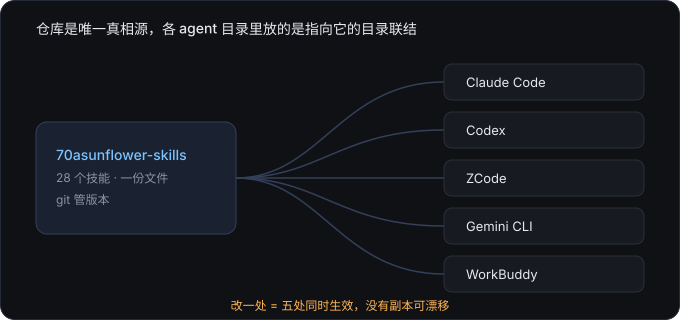

# 70asunflower skills

> 把做过的事、踩过的坑、验证过的流程，写成 agent 能直接调用的技能。
> 一份内容，五个 agent 共用——不复制，不漂移。




## 先看这几个

28 个技能里，最能说明这套东西怎么用的是这六个：

| 技能 | 它解决什么 |
|---|---|
| [agent-skills-sync](./agent-skills-sync/) | 五个 agent 共享同一份技能，靠目录联结而不是复制。这个仓库的地基 |
| [project-init](./project-init/) | 新建项目第一件事：立 git、立规范、立留痕，而不是先建目录写文件 |
| [project-review](./project-review/) | 给项目打分：六维审查、透明扣分、按优先级给修复清单 |
| [layoutfix](./layoutfix/) | 查矢量图里字压图、文字被盖、箭头悬空；还能起个界面用鼠标拖，改动落成可重放的清单 |
| [snap](./snap/) | 一条命令截图/体检/像素对比，零依赖。交付前确认页面真的没坏 |
| [paper-writing](./paper-writing/) | 工程论文写作的六个可执行模式：audit / rewrite / causal-chain / forensic / cite-lint / budget-control |

## 为什么是「一份文件」而不是「每个 agent 一份」

技能本身是内容，真正的设计在**怎么分发给多个 agent**：

| 做法 | 后果 |
|---|---|
| 每个 agent 目录各放一份副本 | 改了一处忘另一处，两周后六份内容各不相同，还分不清哪份是对的 |
| 一个仓库 + 目录联结（junction） | 只有一份文件，改哪里都是改这一份 |

由此推出三条硬规矩：

1. **不复制、不另存、不"先备份一份"**——副本会立刻漂移，旧版本靠 git 历史取回
2. **新增技能建在仓库里** `<skill>/SKILL.md`，不在 agent 目录下新建真实目录（会脱离仓库）
3. **删技能必须同步清理联结**——主库删了目录，各 agent 里那条 junction 变成指向空路径的空壳，不报错但行为不可预期

一次删 7 个技能会在 6 个 agent 目录里留下 42 条断链。所以 `doctor` 不返回「问题数: 0」就不算做完。

第三方技能是例外：**按渠道各自保留、不入库**。它们渠道参数不同，不是版本差异。

## 怎么用

最简单的用法是复制单个技能目录：

```bash
cp -r project-init ~/.claude/skills/
```

想长期用、且装了多个 agent，就按 [`agent-skills-sync`](./agent-skills-sync/) 的做法把目录挂成联结，改一处全部生效。

各 agent 的技能目录：

- WorkBuddy：`~/.workbuddy/skills/`
- Claude Code：`~/.claude/skills/`
- Codex：`~/.codex/skills/`
- ZCode：`~/.zcode/skills/`
- Gemini CLI：`~/.gemini/config/skills/`
- Antigravity：`~/.gemini/config/skills.json`（原生声明式直挂主库，避开 Windows Junction 限制）

技能由 agent 按描述自动触发，不需要记命令——每个 `SKILL.md` 开头的 `description` 就是触发条件。

## 全部 28 个技能

按用途分组。标 `personal` 的绑了个人路径 / 账号 / 登录态，别人装了要改配置；
其余可以直接拿去用（个别技能含本机解释器路径，按需改一行）。

### 学术与论文 — 写、审、画图、调研报告

| 技能 | 说明 |
|---|---|
| [paper-writing](./paper-writing/) | 工程论文写作：六个可执行模式（audit / rewrite / causal-chain / forensic / cite-lint / budget-control）+ 十项铁律 + 反模式库 + IEEE 会议模板 + 引用升序与投稿打包脚本；审阅归 paper-review、画图归 paper-figures |
| [paper-review](./paper-review/) | LaTeX/IEEEtran 论文投稿前审阅与修改：本机编译环境、静态健康、句级审阅、术语与引用、图表与陈述强度一致性 |
| [paper-figures](./paper-figures/) | 学术图表统一入口：matplotlib 投稿矢量图 / Origin 可编辑直通 / python-pptx 示意图三条管线按用途路由；含期刊海报与图文摘要模板、色盲安全检查、视觉一致性校验 |
| [deep-research-report-pipeline](./deep-research-report-pipeline/) | 工程决策类深度调研报告流水线：全网调研 → 分章撰写 → 独立审稿（数字比对 + 独立重算）→ 跨章对齐 → 语言优化 → 整合交付 |

### 图与视觉 — 把内容做成图、检查图有没有毛病

| 技能 | 说明 |
|---|---|
| [visual-diagrams](./visual-diagrams/) | 把内容做成图：信息卡长图（HTML/CSS + Playwright）、示意图流程图（手写 SVG → Chrome → 思源）、技术架构图（调用外部 fireworks 风格库）。按输出类型路由，含命名/导出/校验约定；论文数据图与海报归 paper-figures |
| [snap](./snap/) | 零依赖页面截图/体检/像素对比 CLI：无头 Chrome 一条命令截图（整页/元素/区域/高清），--audit 程序化检坏图溢出裁切，--diff 视觉回归；agent 确认页面渲染效果首选 |
| [layoutfix](./layoutfix/) | 矢量图版面体检与人工微调：查字压图/文字被盖/超画布/箭头悬空/标签偏心，输出毫米级违例清单（--strict 可做交付门禁）；tune 起本地界面人拖即存盘，改动落成可重放的 delta 清单 |

### 文档与写作 — 格式转换、排版规范、教程生成

| 技能 | 说明 |
|---|---|
| [md-to-70asunflower-latex](./md-to-70asunflower-latex/) | 将 Markdown 技术博客转换为 70asunflower 风格的 LaTeX 文档，适配 Overleaf XeLaTeX 编译 |
| [md2docx-formal](./md2docx-formal/) | 将 Markdown 中文工程文档转换为规范排版的 Word（A4、篇/章/节标题层级、1.5 倍行距、自动目录、页眉页脚、GB/T 7714 引用上标），并支持源文档一致性审查 |
| [strict-docx-audit](./strict-docx-audit/) | docx 转换后的质量闸：12 项结构与排版检查 |
| [doc-plain-zh](./doc-plain-zh/) | 中文文档可读性转换：拗口 → 通顺，只改表达、不改逻辑与事实，保持书面正式 |
| [weekreport](./weekreport/) | 零散工作要点 → 周报正文：结论先行 + 产出必须具名 + 六条「让产出可见」的结构规则（放弃写成决策、旧目标闭环、下周可验收、累计进度）+ 周报特有的九种 AI 味清单 + 扩充只扩表达不扩事实；通用去 AI 味归 humanizer-zh，含六个场景的前后对照 |
| [tutorial-writer](./tutorial-writer/) | 为初学者生成详细、正确、图文并茂的学习文档/教程：调研核验 → 依赖排序大纲 → 写作 → 配图（svg-diagram-pipeline）→ 润色（humanizer-zh）→ 三道门自查 → 交付（本地 md，可选思源） |
| [ai-tutorial-pipeline](./ai-tutorial-pipeline/) | 用网页版 AI 按大纲逐章生成高质量教程并自动入库思源笔记，含浏览器接管、表格/公式格式校验 |

### 笔记与知识库 — 思源 / Notion 的读写、排版与备份

| 技能 | 说明 |
|---|---|
| [siyuan-kernel-ops](./siyuan-kernel-ops/) | 通过思源内核 HTTP API 安全检索/读写/批量处理笔记库，含端口漂移、上传、索引滞后等坑位手册 |
| [siyuan-backup-sync](./siyuan-backup-sync/) | 思源笔记数据仓库的 Git 备份/同步工作流 |
| [siyuan-markdown-formula-formatter](./siyuan-markdown-formula-formatter/) | 思源专用 Markdown/LaTeX 公式排版规范，彻底解决公式渲染失败 |
| [notion-im-helper](./notion-im-helper/) | 通过 IM 向 Notion 添加内容，支持闪念速记、待办清单、标题、引用、列表等多种格式 |

### 工程与项目 — 项目脚手架、代码修改、CAD、工具链维护

| 技能 | 说明 |
|---|---|
| [agent-skills-sync](./agent-skills-sync/) | 多 agent（WorkBuddy/Claude/Codex/ZCode/Gemini）共享用户级技能的单一真相源：junction 分发、状态矩阵、漂移分类与冲突保护 |
| [project-init](./project-init/) | 项目底线生成器：git + AGENTS.md（唯一规范来源）+ 三层留痕（项目记忆 / 项目日日志 / 逐文件 `.log.md`，条目带模型 id）+ 命名硬约束；结构按 minimal/docs/software 预设或自定义声明，agent 入口由各 agent 按需自建；含接管/升级/巡检 |
| [project-review](./project-review/) | 项目六维审查评分 + 审计报告，与 project-init 互补 |
| [notebook-patching](./notebook-patching/) | Jupyter Notebook (.ipynb) 与 IDE 打开状态下的受限文件快速安全修改工作流，规避内联转义与 Auto-Save 内存覆盖冲突 |
| [3d-printing-cad-design](./3d-printing-cad-design/) | 3D 打印机械 CAD 全流程：build123d / CadQuery 参数化建模、水密性网格校验、STEP→GLB 离线预览、制造交付打包 |
| [feishu-bot-config](./feishu-bot-config/) | 飞书机器人配置管理工具，自动化添加、管理和排查飞书机器人集成 |

### 个人工作流 — 绑了个人路径 / 账号 / 登录态，别人装了要改

| 技能 | 说明 |
|---|---|
| [investment-analysis](./investment-analysis/) | `personal` · 个人投资分析方法论与操作规程（林奇六分类 + 预测档案系统），含个人工作区路径 |
| [captain-resource](./captain-resource/) | `personal` · 资源入库助手，将 URL/文章/工具等添加到 ai-learning-journey、embodied-ai-learning、ic-chip-design-learning 三个学习仓库 |
| [xhs-pipeline](./xhs-pipeline/) | `personal` · 小红书信息收集流水线（profile 驱动：搜索/抓取/审读/合并入库），依赖本机浏览器登录态 |
| [trek-mcp-ops](./trek-mcp-ops/) | `personal` · 自部署 TREK 旅行规划器（Docker + 内置 MCP 135 工具）的启停/建行程/排障手册，含本机端口与代理配置 |

## 维护本仓库

以下命令都在仓库根目录执行。

```bash
python scripts/skillsync.py status          # 每个 agent 每个技能的链接状态矩阵
python scripts/skillsync.py doctor          # 断链 / 链式嵌套 / 主库含链接；应为「问题数: 0」
python scripts/skillsync.py scan            # 多副本漂移报告
python scripts/skillsync.py prune           # 清理断链（默认 dry-run，加 --apply 才删）
python scripts/lint_skills.py               # 技能规范检查（frontmatter / 描述长度 / 引用 / BOM）
python scripts/check_consistency.py         # README 与技能目录双向一致
```

| 做什么 | 动手 | 收尾（缺一步都算没做完） |
|---|---|---|
| **改**已有技能 | 直接编辑 | `lint_skills.py` 无 error |
| **加**新技能 | 建 `<skill>/SKILL.md` + 在 README 加一行 | `link --apply` → `doctor` 回 0 |
| **删**技能 | `git rm -r <skill>` + 从 README 删行 | `prune --apply` → `doctor` 回 0 |

提交时 `.git/hooks/pre-commit` 会自动跑**一致性 + 技能规范 + 结构**三道闸门，有 error 直接拒绝。

技能怎么写、提交怎么署名、维护时该删什么，统一记在 [`AGENTS.md`](./AGENTS.md)——那是唯一权威源，
改完跑 `python scripts/skillsync.py rules --apply` 分发到各 agent 的全局指令文件。

`scripts/sync_zcode_skills.py` 已废弃并内置拒绝执行的保护——旧逻辑是「先删除仓库目录、再从
agent 目录复制」，在 junction 布局下方向相反，会把仓库内容覆盖掉。

## 外部技能

除上表收录的自制技能外，本机还统一管理着一批外部技能——包括 `humanizer-zh`（去 AI 味润色，MIT，来自 op7418/Humanizer-zh）、`kimi-webbridge`（浏览器接管）、`mcporter`（MCP 调度）、`fireworks-tech-graph`（SVG 图形）等。它们以完全相同的 junction 方式分发到各 agent，但**不纳入本仓库版本控制**（见 `.gitignore` 的 `skillsync` 标记区块），只随目录存在于本机。

其中 `humanizer-zh` 已被定为**写长文时的固定动作**：报告、方案、论文、正式文档、README、汇报材料等长文本，产出草稿后过一遍该技能再交付。

判定为第三方的不能只看「git 未跟踪」，那和「刚建的新技能」无法区分；`.gitignore` 的区块现在**只减不增**，要排除新目录得显式 `skillsync.py gitignore --add <name>`。

## 许可

[MIT](./LICENSE) © 2026 70asunflower

拿去用、改、商用都行，保留版权声明即可。标了 `personal` 的技能绑了个人路径、账号或登录态，
直接跑会失败——按里面的说明改成你自己的就能用。
