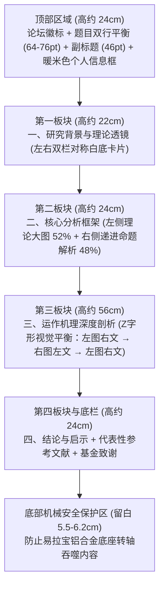

# academic-poster — 学术海报与易拉宝独立设计与修改技能包

本技能沉淀自顶尖高校学术会议易拉宝（60cm × 160cm 竖版）从论文内容提炼、信息可视化绘图、印刷级 PDF 生产到 **100% 像素级对齐的可编辑 PPTX** 交付的完整实战体系。作为一个**完全独立、零外部依赖、即拷即用**的技能包，方便直接分享给朋友或协作 Agent 进行后续的海报修改、排版调整与最终送印。

---

## 零、双轨交付核心哲学（Dual-Track Pipeline）

在学术海报任务中，交付物的核心痛点是**“印刷质量”与“用户自主修改权”的冲突**：
- **仅给 PDF/图片**：虽然印刷精度达标，但用户或导师临场想要修改一个错别字、微调作者单位或更新插图时**完全无法编辑**；
- **仅给 PPTX**：PowerPoint 存在 **56 英寸（142.24 cm）最大画布物理上限**，根本无法直接新建 160cm 的画卷；且若不处理底层 XML，中文字体、圆角曲率、阴影和标点折行在不同电脑上打开会彻底走样。

**本技能的刚性铁律：必须双轨同步交付！**
1. **印刷级 PDF**：ReportLab 生成，1:1 物理尺寸（含 3mm 出血与裁切线），CMYK 色彩，300 DPI 矢量级渲染，用于直供印刷厂出片；
2. **可编辑 PPTX**：`python-pptx` 纯原生矢量构建，严格遵循 **1:2 几何与字号缩放**，全原生形状与文本框，用户在任何 Office/WPS 中可自由双击修改，视觉观感与 PDF 100% 像素级对齐。

---

## 〇·五、本机运行环境

运行海报管线脚本时，推荐解释器指向已配置好环境的 Python 环境：

| 模块 | 推荐解释器路径 | 必备依赖库 |
|---|---|---|
| PDF / PPTX / 绘图 / 质检比对 | `C:/Users/qilin/miniconda3/python.exe` (或任意 Python 3.9+) | `reportlab`, `python-pptx`, `pymupdf` (fitz), `pywin32`, `matplotlib`, `Pillow`, `numpy` |

---

## 一、物理印刷与画布参数（硬性标准）

### 1. 易拉宝尺寸与机械结构
- **成品尺寸**：$60\text{ cm} \times 160\text{ cm}$（宽高比 3:8，国内学术会议展台黄金规格）；
- **含出血画布尺寸**：$60.6\text{ cm} \times 160.6\text{ cm}$（四边各向外预留 3mm 出血，总增宽增高 6mm）；
- **安全边距（Safe Margin）**：裁切线向内缩进 $2.0\text{ cm}$ 作为安全框（所有文字、图表必须限制在中心 $56\text{ cm} \times 156\text{ cm}$ 内）；
- **【极其重要】底座卷轴机械留白（Bottom Cassette Clearance）**：
  易拉宝画卷底部需固定在金属底座的弹簧转轴内，底座边缘和机械扣条会遮挡底部约 **3–5 cm**。
  **画布最底部 5.5–6.2 cm（在 1:2 PPTX 中为 2.7–3.1 cm）必须留白**，严禁排布任何文字、正文、参考文献或基金信息！

### 2. 色彩与分辨率规范
- **色彩模式**：PDF 必须采用 **CMYK**（四色印刷模式）；
- **分辨率**：位图素材与预览光栅图必须达到 **300 DPI**；
- **经典学术配色标准**：
  - **学院深蓝（主色）**：`#0F294A` / CMYK `(0.95, 0.75, 0.25, 0.35)` —— 一级标题横幅背景、主标题文字；
  - **暖琥珀金（强调色）**：`#C28212` / CMYK `(0.12, 0.40, 0.95, 0.05)` —— 标题左侧竖条装饰、核心机制高亮节点、重点标签；
  - **板岩雅蓝（辅助色）**：`#2B4C7E` / CMYK `(0.80, 0.50, 0.20, 0.10)` —— 二级分类胶囊标题、箭头连接线；
  - **极浅学术白（卡片底）**：`#F8FAFC` / CMYK `(0.01, 0.01, 0.02, 0.01)` —— 正文卡片底色；
  - **暖米色（作者信息底）**：`#FEFCF7` / CMYK `(0.02, 0.03, 0.07, 0.00)` —— 顶部个人与论文信息框。

---

## 二、PowerPoint 1:2 几何缩放铁律（破解 56 英寸物理天花板）

### 1. 为什么不能直接做 1:1 PPTX？
Microsoft PowerPoint 内部 slide 尺寸上限为 **56 英寸（142.24 cm）**。一旦将 `slide_height` 设为 160cm，Office 会直接抛出 OLE 溢出异常或拒绝打开。

### 2. 1:2 严格数学映射公理
PPTX 必须采用严格的 **1:2 几何缩放**：

$$W_{\text{pptx}} = \frac{W_{\text{pdf}}}{2} = 30.0\text{ cm}, \quad H_{\text{pptx}} = \frac{H_{\text{pdf}}}{2} = 80.0\text{ cm}$$

所有几何坐标、卡片宽高、间距、线宽与**字号**全部严格 $\div 2$：

| 元素层级 | 1:1 PDF 印刷字号 | 1:2 PPTX 编辑版字号 | 字体族 | 样式与规范 |
|---|---|---|---|---|
| **论坛顶标** | 28 pt | 14.0 pt | 黑体 / SimHei | 白字深蓝底或板岩蓝 |
| **海报主标题** | 64 – 76 pt | 32.0 – 38.0 pt | 黑体 / SimHei | 加粗、居中、深蓝、双行平衡 |
| **海报副标题** | 46 – 48 pt | 23.0 – 24.0 pt | 黑体 / SimHei | 居中、深蓝或炭黑 |
| **一级标题横幅** | 44 – 46 pt | 22.0 – 23.0 pt | 黑体 / SimHei | 白字深蓝通栏横幅，左侧琥珀金条 |
| **二级胶囊标题** | 28 – 32 pt | 14.0 – 16.0 pt | 黑体 / SimHei | 白字深蓝圆角胶囊或分类标签 |
| **正文文字（硬底线）** | **$\ge 30.0$ pt** | **$\ge 15.0$ pt** | 思源宋体 / Noto Serif SC | 行距 1.30–1.35，关键词加粗 |
| **图注（Caption）** | 22 – 24 pt | 11.0 – 12.0 pt | 思源宋体 / Noto Serif SC | 加粗、置于图表正下方居中 |
| **图内标注文字** | **$\ge 22.0$ pt** | **$\ge 11.0$ pt** | 黑体 / 思源宋体 | 必须全部水平排布，严禁小于 11pt |
| **参考文献与基金** | 22 – 24 pt | 11.0 – 12.0 pt | 思源宋体 / Noto Serif SC | 紧凑排布，思源宋体 |

> [!CAUTION]
> **正文字号绝对硬红线**：1:1 下绝对不可小于 30pt，对应 PPTX 下绝对不可小于 15pt！小于 15pt 会导致展会现场站立参会者完全无法阅读。

---

## 三、python-pptx 底层 OpenXML 注入关键技术

本技能内置共享库 `scripts/pptx_core.py`，彻底解决原生 `python-pptx` 的四大缺陷：
1. **东亚中文字体声明 (`<a:ea>`)**：解决 Office 在 Windows 下中文字体回退失效的 Bug（`apply_east_asian_font`）；
2. **精细微圆角控制 (`adj=3000`)**：抹平 PPT 默认 `adj=16667` 的过圆廉价感，获得端庄卡片（`set_round_radius`）；
3. **彻底移除形状阴影 (`<a:effectLst>`)**：剥离模糊灰影，维持现代扁平学术矢量风格（`remove_shadow`）；
4. **文本框内边距清零 (`margin=0`)**：清除默认 2.54mm 内边距，确保排版净宽完全符合精确计算。

---

## 四、中文学术排版与标点避头尾禁则（CJK Typesetting）

- **现象**：逗号 `，`、句号 `。`、分号 `；` 掉落到下一行行首，破坏学术庄严度。
- **三大对策**：
  1. **精确字符容积法**：排版文本框净宽必须按字号留出 2–3mm 标点避让缓冲区（例如 15pt 字号一行容纳 27 字时，文本框净宽统一设为 $14.5\sim 14.6\text{ cm}$）；
  2. **语法意群主动断行法**：在复杂长难句的多分句逗号处显式换行（`，\n`），保证标点永远固定在上一行末尾；
  3. **标签悬挂缩进**：加粗标签 `【标签】` 与正文在同一段落流式排布，ReportLab 采用 `firstLineIndent=-15.5pt`，PPTX 采用 `pptx_core.add_bullet_card_paragraph(...)`。

---

## 五、学术海报图表绘制黄金法则（0 度水平文字铁律）

海报主要供站立阅读（视距 1.5–3 米），倾斜头部看斜线文字属于严重反人类设计。
- **【0 度水平文字】**：任何连线、斜向箭头上的标注文字**必须绝对保持 0 度水平**，严禁旋转角度！
- **【竖排字符自然堆叠】**：当指示长矩形为竖直方向时，汉字采用换行自然坚排（`内\n容\n联\n动`），绝不旋转文本框 90 度！
- **【文字防穿帮白色遮罩】**：文字与连线交错处，必须配置带 padding 的纯白底色块遮罩（`bbox=dict(facecolor='white', pad=2.0)`），防止线条穿字。
- **【图内字号下限】**：海报图内所有文字 1:1 下绝对 $\ge 22\text{ pt}$（PPTX 1:2 下 $\ge 11.0\text{ pt}$）。

---

## 六、易拉宝黄金四段式信息架构

60cm × 160cm 典型版面预算分配方案：



---

## 七、协作者如何继续修改海报？（两种方式）

详细步骤参阅配套文档 [`references/how_to_modify_poster.md`](file:///C:/Users/qilin/.gemini/config/skills/academic-poster/references/how_to_modify_poster.md)：

### 方式 1：直接在 PowerPoint 中可视化修改（推荐给朋友/合作者）
1. 用 PowerPoint 打开 `academic_poster_30x80cm.pptx`；
2. 双击任意文字框直接修改文本、更换作者信息或微调论点；
3. 替换插图：选中旧图删除，直接拖拽新图居中放置；
4. 送印说明：直接将 PPTX 另存为 PDF，或交代印刷店师傅**“按 1:2 尺寸制作，请等比放大 200% 喷绘至 60cm × 160cm”**。

### 方式 2：通过 Python 脚本全自动编译与质检
1. 修改脚本 `template_poster_pptx.py` 或 `template_poster_pdf.py` 内部数据与文案；
2. 运行生成命令更新文件；
3. 运行质检脚本：
   ```bash
   python scripts/verify_poster_diff.py academic_poster_60x160cm.pdf academic_poster_30x80cm.pptx
   ```
   自动切出 4 个视区切片比对，核查标点避头尾与底座留白。

---

## 八、技能内置工具脚本与参考资产

技能包完全自给自足，所有资源均位于本地目录：

```
academic-poster/
├── SKILL.md                          # 技能主规范与全流程执行指南
├── references/
│   ├── how_to_modify_poster.md       # ★ 协作者修改与送印指引
│   ├── print_specifications.md       # 易拉宝物理印刷参数、CMYK色值表、底座机械结构
│   ├── openxml_pptx_hacks.md         # OpenXML 底层样式与东亚字体注入代码
│   ├── typography_and_cjk.md         # 中文排版、标点避头尾与字符容积计算
│   └── diagram_horizontal_discipline.md # 0 度水平文字与无遮挡遮罩铁律
└── scripts/
    ├── pptx_core.py                  # ★ 原生 PPTX 矢量控制核心库
    ├── template_poster_pdf.py        # ReportLab 60.6x160.6cm 印刷级 PDF 生成器
    ├── template_poster_pptx.py       # python-pptx 30x80cm 矢量可编辑版生成器
    ├── template_figure_diagram.py    # matplotlib 0 度水平文字学术机制图模板
    └── verify_poster_diff.py         # PDF vs PPTX 自动切片像素比对与质检工具
```
