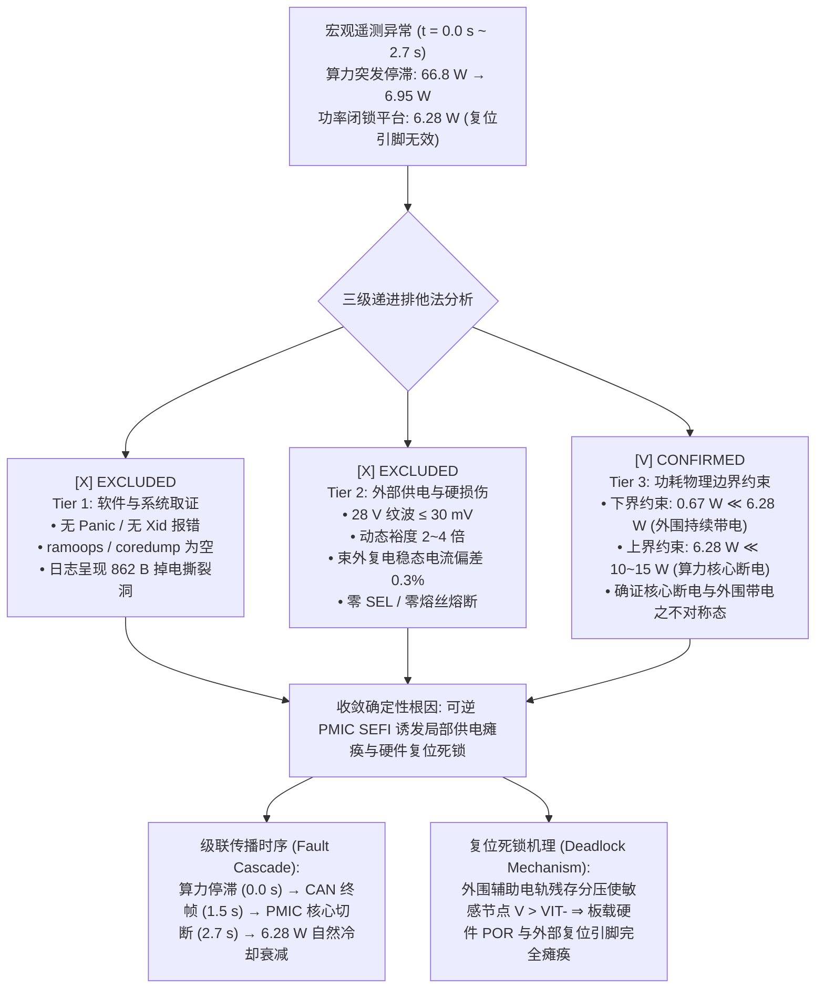

# 三级递进排他法物理归因框架模板 (Three-Tier Orthogonal Elimination Framework)

在复杂硬件系统（如 COTS 异构计算整机、星载计算机、嵌入式工控机）发生辐射失效、供电异常或复位闭锁时，严禁主观臆断单一原因。必须构建**自顶向下、软硬件协同的三层递进排他法分析矩阵**：

---

## 1. 系统失效排他法归因矩阵 (System Failure Elimination Matrix)

| 排除层级 (Audit Tier) | 假设失效模式 (Candidate Failure) | 关键测试表征与观测证据 (Empirical Signatures & Telemetry) | 判定结论 (Finding) | 结论依据 (Basis) |
|:---|:---|:---|:---:|:---|
| **Tier 1: 软件与系统取证** (Software & OS Health) | 操作系统崩溃 / 内核死锁 (OS Kernel Panic / Deadlock) | 1. 串口控制台与网络心跳无告警输出 2. 离线提取 NVMe SSD：`ramoops` / `pstore` 转储为空 3. `last_boot = 0x0`，无系统崩溃标记 4. 遥测日志文件出现 862 B 断电撕裂空洞 (torn log hole) | ❌ **排除** (Excluded) | 证明操作系统未经历标准崩溃流程，故障发生在更底层，直接被瞬间切断执行环境。 |
| **Tier 2: 外部供电与硬损伤** (Supply Integrity & Hard Damage) | 外部母线失稳 / 硬件烧毁 / SEL (Supply Fluctuation / Latchup / Damage) | 1. 28 V 稳压电源纹波 $\le 30\text{ mV}$，负载卸脱电压回弹至 28.0299 V 2. 动态电流裕度留有 2~4 倍，无欠流/过流保护触发 3. 束外冷复电测试：5 次冷启动稳态电流 $742.6 \pm 1.8\text{ mA}$，与受照前基线 $745.0 \pm 2.1\text{ mA}$ 偏差仅 $0.32\%$ | ❌ **排除** (Excluded) | 外部供电极度稳固；冷启动所有子系统（CPU/GPU/DRAM/SSD/外设）功能 100% 恢复，无微熔丝熔断或持续 SEL。 |
| **Tier 3: 功耗边界约束** (Power Bounding & Asymmetry) | 1. 整机全板掉电 (Full Board Cutoff) 2. 纯逻辑死锁挂起 (Pure Logic Hang) 3. **局部供电坍塌与复位死锁 (Partial Power Collapse)** | 1. **下界物理约束**：系统软关机功耗 $0.67\text{ W} \ll 6.28\text{ W}$，确证外围载板与辅助转换电路持续带电； 2. **上界物理约束**：均值平台 $6.28\text{ W} \ll 10\sim 15\text{ W}$ 核心空闲基线，确证主算力核心（CPU/GPU）已彻底失电； 3. 功耗随自然散热以 $-0.053\text{ W/min}$ 线性缓降，符合亚阈值漏电温度依赖衰减。 | ✅ **确认** (Confirmed) | **核心与外围供电不对称**：开关调压器 (PMIC/VRM) 控制链路 SEFI 误触发欠压锁定 (UVLO) 关断核心电轨；外围残存电压阻碍复位激活 ($V > V_{\text{IT-}}$)，导致复位死锁。 |

---

## 2. 故障树级联推导路径 (Fault Cascade & Deadlock Mechanism)

