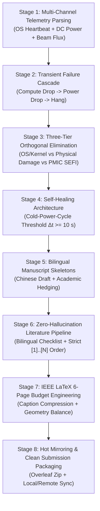

# Satellite Computing Paper Pipeline (v1.0)

A standardized, highly repeatable end-to-end pipeline and agent skill for authoring, reviewing, formatting, and packaging peer-reviewed engineering manuscripts in the field of **Satellite Edge Computing, Space Radiation Reliability, and Mission-Critical Embedded Systems**.

This skill directly encapsulates the rigorous methodological workflow developed for top-tier IEEE aerospace and computing venues (such as IEEE Satellite, IEEE Transactions on Aerospace and Electronic Systems, IEEE TNS, and IEEE Aero).

---

## 1. Pipeline Overview & Lifecycle Stages



---

## 2. The 8 Operational Execution Phases

### Phase 1: In-Situ Telemetry & Multi-Channel Transient Parsing
- **Principle**: Decouple and timestamp all observables across three non-interfering channels:
  1. *In-band software channel*: Workload compute rate, system logs (`dmesg`), network ping, and OS heartbeats.
  2. *Primary bus electrical channel*: High-speed DC voltage, current, and true operational power (e.g., 66.8 W peak load down to 6.28 W fault plateau).
  3. *Physical & dosimetry channel*: Proton beam energy (e.g., 48 MeV), target flux, and cumulative fluence to failure ($\Phi_{\text{crit}}$).
- **Deliverable**: A time-synchronized event breakdown table linking physical particle arrival to electrical and logical state transitions.

### Phase 2: Three-Tier Orthogonal Causal Elimination
- **Principle**: Never assert a failure cause by speculation. Systematically refute alternative hypotheses using incompatible quantitative evidence via `templates/elimination_framework_template.md`:
  - **Tier 1 (Software/OS Level)**: Rule out CPU hang / kernel deadlock because system power dropped precipitously rather than staying high, and hardware reset lines remained locked.
  - **Tier 2 (Destructive Physical Level)**: Rule out destructive Single-Event Latchup (SEL) or junction burnout because current dropped drastically and full operational integrity was restored post-recovery.
  - **Tier 3 (Power Domain SEFI Level)**: Attribute to PMIC register upset where secondary auxiliary rails remained energized (drawing ~6.28 W standby) while core voltage rails collapsed.

### Phase 3: Hardware Self-Healing Parameter Validation ($\Delta t_{\text{off}} \ge 10\text{ s}$)
- **Principle**: Space self-healing watchdogs must account for analog circuit physics:
  - High-performance COTS computing boards embed massive bulk capacitance banks ($C_{\text{bulk}} > 1000\ \mu\text{F}$).
  - Sub-second or instantaneous power toggling fails to discharge parasitic rails below the PMIC logic trip threshold ($<0.1\text{ V}$), locking the controller in SEFI.
  - Require an empirical cold-power-off decay time $\Delta t_{\text{off}} \ge 10\text{ s}$ to guarantee full rail collapse and clean power-on-reset (POR).

### Phase 4: Tone Calibration & Academic Hedging
- **Rule of Hedging**: If a hardware feature was uncalibrated or inactive during the radiation run (e.g., memory ECC or unmonitored coprocessors), blur the claim:
  - *Do NOT say*: "ECC was broken and allowed corrupted data."
  - *DO say*: "The benchmark operated under standard baseline memory settings without auxiliary parity intervention."
- **De-Hyping**: Remove promotional marketing words (*revolutionary*, *breakthrough*, *unprecedented*); replace with measured engineering descriptors (*deterministic recovery*, *in-situ characterization*, *sub-100 ms fault detection*).

### Phase 5: Zero-Hallucination Monotonic Literature Pipeline
- **Principle**: Maintain an authoritative bilingual tracking matrix (`_文献回填清单.md`) using `templates/literature_checklist_template.md`.
- **Monotonic Ascending Citations**:
  - References in the body text must appear in strictly ascending numerical order (`[1]`, `[2]`, `[3]`, ..., `[N]`).
  - No forward jumps (e.g., introducing `[7]` before `[4]`).
  - Zero orphan references in the bibliography.
- **Verification Command**:
  ```bash
  python scripts/check_monotonic_citations.py --tex paper.tex --checklist _文献回填清单.md
  ```

### Phase 6: Strict 6-Page IEEE LaTeX Budget Engineering
- **Template**: Use `templates/paper_en_ieee_template.tex` as the base document.
- **Page Ceiling Control**:
  - Conference limit (typically 6 pages) is a hard ceiling: Page 7 by even a single line results in administrative desk rejection.
  - Keep figure and table captions concise ($<40$ words) to reclaim vertical whitespace.
  - Use `\usepackage{booktabs}` for compact, professional tables without vertical lines.
  - Balance columns on the final page using `\IEEEtriggeratref{N}` or `\usepackage{balance}`.

### Phase 7: Scalable Vector & High-DPI Figure Pipeline
- **Vector Standard**: All final figures inserted into LaTeX must be vector PDFs (`fig1.pdf`, `fig2.pdf`, `fig3.pdf`) with embedded fonts to ensure crisp rendering at any magnification.
- **Preview Standard**: Render 300+ DPI PNG assets for Markdown drafts, reviewer slides, and web inspection.
- **Automation Command**:
  ```bash
  python scripts/convert_figures.py --input-dir figures/ --dpi 300
  ```

### Phase 8: Dual Mirror Sync & Clean Submission Packaging
- **Principle**: Prevent local drive desynchronization and ensure a one-click clean package for Overleaf / EDAS / IEEE CPS upload.
- **Exclusion Filters**: Filter out compiler artifacts (`*.aux`, `*.log`, `*.out`, `*.bbl`, `*.blg`, `*.synctex.gz`).
- **Automation Command**:
  ```bash
  python scripts/sync_mirror_and_pack.py \
    --src "d:/Project/workspace/ky" \
    --mirror "D:/MyData/ZL/论文/2026 International Conference on Satellite Computing (Satellite)" \
    --zip "satellite_paper_submission.zip"
  ```

---

## 3. Directory Layout of the Skill

```text
satellite-computing-paper-pipeline/
├── SKILL.md                                 # Skill entry point and full lifecycle specification
├── references/
│   └── ieee_conference_iron_rules.md       # 12 Universal Iron Rules & pre-flight submission checklist
├── templates/
│   ├── paper_zh_template.md                # 7-chapter Chinese engineering draft template
│   ├── paper_en_ieee_template.tex          # IEEEtran double-column 6-page LaTeX template
│   ├── elimination_framework_template.md   # Three-tier orthogonal fault elimination matrix & tree
│   └── literature_checklist_template.md    # Bilingual literature verification checklist
└── scripts/
    ├── check_monotonic_citations.py        # Strict [1]..[N] ascending citation sequence linter
    ├── convert_figures.py                  # PyMuPDF vector PDF to 300 DPI PNG converter
    └── sync_mirror_and_pack.py             # Dual-directory mirroring & clean submission packager
```

---

## 4. Quick Execution Commands

| Task | Command Line |
| :--- | :--- |
| **Verify Citation Ordering** | `python scripts/check_monotonic_citations.py -t paper.tex -c _文献回填清单.md` |
| **Rasterize Vector Figures** | `python scripts/convert_figures.py -d ./figures` |
| **Sync Mirror & Package Zip** | `python scripts/sync_mirror_and_pack.py -s . -m "<MirrorPath>" -z submission.zip` |

---

## 5. Reviewer-Facing Defense Checklist

1. **Why not just perform software watchdog resets?**
   * *Defense*: Software watchdogs run on the host processor and depend on healthy core voltage rails ($V_{\text{core}}$). In a PMIC SEFI, core rails are latched off, disabling CPU reset logic and requiring an independent out-of-band supervisor.
2. **Why require $\Delta t_{\text{off}} \ge 10\text{ s}$?**
   * *Defense*: Residual bulk capacitance preserves charge above CMOS threshold levels for several seconds. A premature re-power keeps PMIC flip-flops stuck in the latchup/fault state.
3. **Did the proton beam cause permanent displacement damage?**
   * *Defense*: Ruled out through post-irradiation baseline operational testing; all compute benchmarks executed with identical throughput and nominal power draw.
